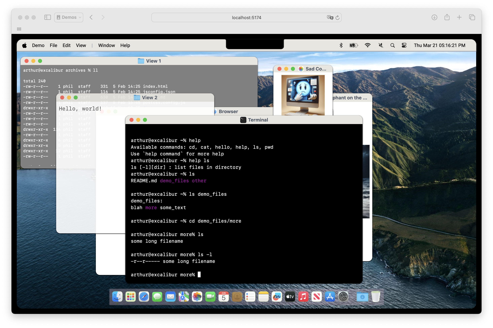

# macos-react

A modern React-based macOS UI simulation with TypeScript, improved performance, and enhanced user experience.



## ✨ New in v3.0

- **Fully migrated to React** with modern hooks and patterns
- **TypeScript** throughout for better type safety
- **Zustand** for lightweight and performant state management
- **Improved performance** with React.memo, useMemo, and useCallback optimizations
- **Better developer experience** with ESLint and TypeScript
- **Modern build tooling** with Vite and React Fast Refresh

## Features

- **Login Screen**: Beautiful login with video background (similar to macOS Sonoma)
- **Functional Menus**: Click-to-open menus with proper state management
- **Advanced Windows**:
  - Drag and drop to move windows
  - Resize from any edge or corner
  - Customizable colors, opacity, and backgrounds
  - Proper z-index management for layering
- **Text Viewer**: Display text files with ANSI color code support
- **Photo Viewer**: Display images with zoom and pan capabilities
- **PDF Viewer**: View PDF documents with navigation controls
- **Terminal Emulator**: Full-featured terminal with built-in commands:
  - `help [cmd]` - Show available commands
  - `ls [-l] [files]` - List directory contents
  - `cd [dir]` - Change directory
  - `pwd` - Print working directory
  - `cat [file]` - Display file contents
  - `history [-c]` - Show or clear command history
  - `clear` - Clear terminal screen
  - Custom commands support
- **Browser**: Embedded iframe browser for web content
- **Plugin System**: Extensible architecture for custom window types
- **State Persistence**: Save and restore session state using localStorage

## Quick Start

### Demo

[Live Demo](https://macos.peergum.com)

### Clone and Run

```bash
git clone https://github.com/peergum/macos-vue.git
cd macos-vue
npm install
npm run dev
```

Visit http://localhost:5173 to see the demo.

## Installation

### Add Package

```bash
npm install --save @peergum/macos-react
```

### Usage in Your App

**main.tsx:**

```tsx
import React from 'react';
import ReactDOM from 'react-dom/client';
import MacOS from '@peergum/macos-react';
import '@peergum/macos-react/dist/style.css';

const definitions = {
  // Your configuration here
};

ReactDOM.createRoot(document.getElementById('root')!).render(
  <React.StrictMode>
    <MacOS definitions={definitions} />
  </React.StrictMode>
);
```

## Configuration

The `definitions` object configures your entire macOS environment:

```tsx
import { MacOSDefinitions } from '@peergum/macos-react';

const definitions: MacOSDefinitions = {
  menu: {
    logo: '<logo_file>', // Optional: Custom logo
    items: [...], // Menu items array
  },
  windows: [
    // Array of window definitions
  ],
  system: {
    dir: {...}, // File system structure
    user: "username",
    host: "hostname",
    commands: {...}, // Custom terminal commands
    fullname: "User Full Name",
    initials: "UN",
    message: "Optional login message",
    password: "optional_password",
  },
  plugins: {
    // Custom plugins
  },
  saverUrl: '<screensaver_video_url>', // Optional
};
```

### Menu Configuration

```tsx
const menuItems = [
  {
    name: "File",
    menu: [
      { name: "New", label: "new" },
      { name: "Open...", label: "open" },
      { name: "---" }, // Separator
      { name: "Quit", label: "quit" },
    ],
  },
  { name: "---" }, // Vertical separator
  { name: "Edit", label: "edit" },
];
```

### Window Types

**Text Viewer:**
```tsx
{
  name: "My Document",
  type: "viewer",
  bg: "gray",
  text: "white",
  w: 600,
  h: 400,
  x: 10,
  y: 20,
  contentUrl: "./files/document.txt",
  // OR
  content: "Static text content",
}
```

**Photo Viewer:**
```tsx
{
  name: "My Photo",
  type: "photo",
  picture: "./images/photo.jpg",
  w: 400,
  h: 600,
  x: 100,
  y: 50,
}
```

**Browser:**
```tsx
{
  name: "Web Browser",
  type: "browser",
  w: 800,
  h: 600,
  x: 200,
  y: 100,
  content: "https://example.com",
}
```

**Terminal:**
```tsx
{
  name: "Terminal",
  type: "terminal",
  w: 700,
  h: 500,
  x: 150,
  y: 150,
  bg: "black",
  text: "white",
}
```

**PDF Viewer:**
```tsx
{
  name: "Document",
  type: "plugin",
  pluginName: "pdf",
  contentUrl: "/path/to/document.pdf",
  w: 600,
  h: 800,
  x: 100,
  y: 50,
}
```

### Custom Terminal Commands

```tsx
const hello = (args: string[]) => {
  if (!args.length) {
    return "Hello!\n";
  }
  return `Hello, ${args.join(' ')}!\n`;
};

const system = {
  commands: {
    hello: [hello, "[name]", "Say hello"],
    // [function, args_description, help_text]
  },
};
```

### File System Structure

```tsx
const dir = {
  files: {
    documents: {
      files: {
        'readme.txt': {
          path: '/files/documents/readme.txt',
          owner: 'user:staff',
          mod: 644,
        },
        subfolder: {
          files: {
            'file.txt': {
              path: '/files/documents/subfolder/file.txt',
              mod: 640,
            },
          },
        },
      },
    },
  },
};
```

### Custom Plugins

```tsx
import MyCustomComponent from './MyCustomComponent';
import icon from './icon.png';

const plugins = {
  myPlugin: [MyCustomComponent, icon],
};

// Use in window:
{
  name: "Custom Window",
  type: "plugin",
  pluginName: "myPlugin",
  w: 500,
  h: 400,
  x: 100,
  y: 100,
}
```

## Development

```bash
# Install dependencies
npm install

# Run development server
npm run dev

# Build for production
npm run build

# Run linter
npm run lint

# Type check
npm run tsc
```

## Architecture

- **React 18** with hooks and functional components
- **TypeScript** for type safety
- **Zustand** for state management
- **Tailwind CSS** for styling
- **Vite** for fast builds and HMR
- **Day.js** for date/time formatting
- **FontAwesome** for icons
- **React PDF Viewer** for PDF support

## Browser Compatibility

Modern browsers with ES2020 support:
- Chrome 80+
- Firefox 75+
- Safari 14+
- Edge 80+

## License

```
MacOS React Component - Simulates a macOS interface
Copyright (C) 2024  Phil Hilger

This program is free software: you can redistribute it and/or modify
it under the terms of the GNU General Public License as published by
the Free Software Foundation, either version 3 of the License, or
(at your option) any later version.

This program is distributed in the hope that it will be useful,
but WITHOUT ANY WARRANTY; without even the implied warranty of
MERCHANTABILITY or FITNESS FOR A PARTICULAR PURPOSE.  See the
GNU General Public License for more details.

You should have received a copy of the GNU General Public License
along with this program.  If not, see <https://www.gnu.org/licenses/>.
```

## Contributing

Issues and pull requests are welcome at [GitHub](https://github.com/peergum/macos-vue/issues)

## Changelog

### v3.0.0 (2025)
- Complete migration from Vue 3 to React 18
- TypeScript throughout
- Zustand for state management
- Improved performance and code quality
- Better documentation
- Modern React patterns (hooks, memo, etc.)

### v2.0.12 (2024)
- Vue 3 implementation
- Terminal functionality
- Window management
- Plugin system

## Credits

Created by [Phil Hilger](https://github.com/peergum)